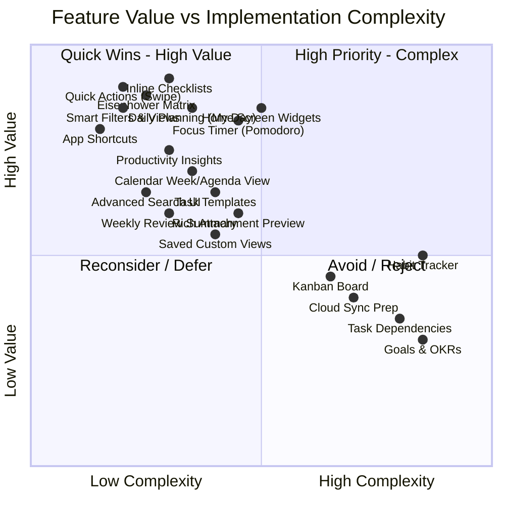
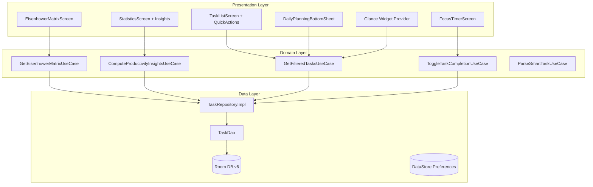
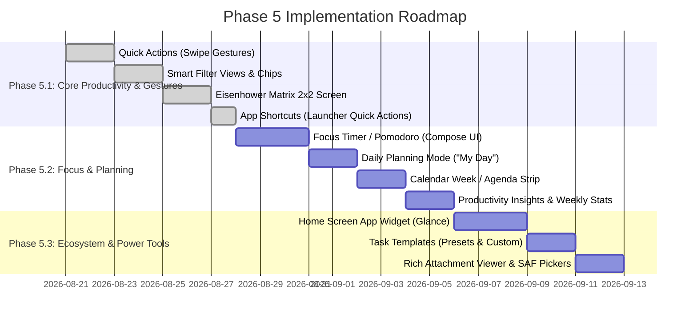

# PishiToDo — Phase 5 Feature Audit & Implementation Plan

> **Document Version**: 1.0.0  
> **Status**: APPROVED ARCHITECTURE & AUDIT BASELINE  
> **Date**: August 2026  
> **Author**: Antigravity Core Architecture Team  
> **Current Baseline**: Phase 4 Production Hardened (Room v6, 103 Unit Tests Passing, lintDebug Clean, Release APK ≈ 3.82 MB, 12 Languages, RTL Verified)

---

## Executive Summary

PishiToDo has achieved a production-hardened baseline across Phases 1 through 4:
- **Phase 1**: Multilingual Architecture (12 languages, Persian RTL, dynamic language switcher)
- **Phase 2**: Multi-tag system with M:N relational integrity and AND/OR filtering
- **Phase 3 & 3.5**: Dual-language Natural Language Processing (Persian & English) & Voice Task Input
- **Phase 3.8.1**: Architecture remediation, clean repository boundaries, transactional operations
- **Phase 4**: Production hardening, R8 shrink rules, Room migration suite (v1→v6), Backup format v3

**Phase 5 Goal**: Expand PishiToDo into a premium, high-craft productivity tool inspired by the best aspects of *Things 3*, *TickTick*, *Todoist*, and *Microsoft To Do*, while strictly adhering to:
1. **Zero unnecessary dependencies** (Preserve sub-4MB APK footprint).
2. **Offline-first & 100% Privacy** (No external cloud accounts, no third-party telemetry, local-first storage).
3. **Database safety** (Maximize features leveraging existing Room schema v6; protect v3 backup compatibility).
4. **Clean Architecture** (Strict separation: Presentation → Domain → Data).
5. **No feature bloat** (Focus on high-leverage workflows that make users significantly more effective).

---

## 1. Current Application Capability Audit

### 1.1 Existing Architecture & Feature Inventory

| Area | Current Implementation | Underlying Technology / Components |
| :--- | :--- | :--- |
| **Tasks** | Full CRUD, Title, Description, Notes, Priority (LOW, MEDIUM, HIGH), Due Date, Creation Date, Updated Date, Order Index (Manual drag-and-drop sort) | `TaskEntity`, `TaskDao`, `TaskRepository`, `TaskUseCases` |
| **Subtasks** | Relational hierarchy (`parentTaskId` FK CASCADE), subtask counts & completed counts aggregated via Room subqueries | `parentTaskId` in `TaskEntity`, `GetSubtasks` |
| **Tags / Labels** | M:N relationships, custom tag colors, AND/OR filter modes, tag management bottom sheet | `TagEntity`, `TaskTagCrossRef`, `TagDao`, `TagUseCases` |
| **Recurrence** | DAILY, WEEKLY, MONTHLY, YEARLY, custom INTERVAL (days), series anchor preservation, automatic next occurrence spawning on completion | `RecurrenceRule`, `RecurrenceEngine`, `ToggleTaskCompletionUseCase` |
| **Reminders** | Exact/inexact notifications via WorkManager, auto-rescheduling/cancelling on task completion toggle | `ReminderWorker`, `ReminderManagerImpl`, `NotificationHelper` |
| **Smart Parsing (NLP)** | Natural language date, time, recurrence, priority, tags, and reminder extraction in Persian (Jalali) and English | `PersianTaskParser`, `EnglishTaskParser`, `LocalTaskParser` |
| **Voice Input** | Speech-to-Text bottom sheet with live transcription and NLP parsing pipeline | `VoiceInputBottomSheet`, Android SpeechRecognizer |
| **Calendar** | Month grid view, Jalali & Gregorian conversion, date selection task stream | `CalendarScreen`, `CalendarViewModel`, `JalaliCalendarConverter` |
| **Statistics** | Total, Done, Active, Overdue counters, Completion Rate %, 7-day trend chart (Vico M3), Category breakdown | `StatisticsScreen`, `StatisticsViewModel`, `vico.compose.m3` |
| **Backup & Restore** | Atomic v3 JSON export/import with checksum, entity relation integrity checks, database maintenance | `BackupUseCases`, `RoomTransactionRunner`, `RoomBackupMaintenance` |
| **Theming & Localization**| Light / Dark / System themes, 12 localized languages, bidirectional RTL layout support | Material 3, `LanguageRepository`, `ThemeRepository` |

---

## 2. Competitive Benchmark & Philosophy

| Competitor | Key Strengths | PishiToDo Differentiation & Philosophy |
| :--- | :--- | :--- |
| **TickTick** | Focus Timer (Pomodoro), Eisenhower Matrix, Habit Tracker, Calendar | Adopt **Focus Timer** and **Eisenhower Matrix**; reject habit bloat to keep task focus razor-sharp. |
| **Todoist** | NLP quick add, Smart filters, Karma productivity points | PishiToDo already matches NLP; adopt **Smart Filter Views** (Today, Overdue, High Priority, Recurring). |
| **Microsoft To Do** | "My Day" daily planning, Step checklists, Widgets | Adopt **"My Day" Daily Planning** and **Home Screen Widgets & Shortcuts** for instant capture. |
| **Google Tasks** | Ultra-minimalist, zero cognitive load | Emulate clean subtask interaction and low latency. |
| **Things 3** | World-class craft, Today/Evening views, Logbook, zero tracking | Emulate the tactile feel, quick actions, and privacy-respecting local storage. |

---

## 3. Comprehensive Evaluation of 20 Feature Candidates

Each candidate is evaluated against: User Value, Technical Complexity, Database Impact, Architecture Impact, APK Size Impact, Maintenance Cost, and Priority Rating.



### Detailed Evaluation Matrix

| # | Feature Candidate | User Value | Complexity | DB Impact | Architecture Impact | APK Impact | Maintenance | Priority | Recommendation |
| :- | :--- | :--- | :--- | :--- | :--- | :--- | :--- | :--- | :--- |
| **1** | **Subtasks / Inline Checklist** | High | Low | **SAFE** (v6) | Low | ~15 KB | Low | **P0** | **RECOMMEND (Phase 5.1)** |
| **2** | **Task Dependencies** | Low | High | MEDIUM (v7) | High | ~35 KB | High | **P3** | **REJECT** (PM bloat for personal todo) |
| **3** | **Eisenhower Matrix View** | High | Low | **SAFE** (v6) | Low | ~20 KB | Very Low | **P0** | **RECOMMEND (Phase 5.1)** |
| **4** | **Kanban Board** | Medium | Medium | **SAFE** (v6) | Medium | ~30 KB | Medium | **P3** | **DEFER** (List/Matrix views are more effective) |
| **5** | **Focus Timer / Pomodoro** | High | Medium | **SAFE** (v6) | Medium | ~40 KB | Medium | **P1** | **RECOMMEND (Phase 5.2)** |
| **6** | **Habit Tracker** | Medium | High | HIGH (v7) | High | ~90 KB | High | **P3** | **REJECT** (Separate domain, causes app bloat) |
| **7** | **Goals & Milestones** | Low | High | HIGH (v7) | High | ~80 KB | High | **P3** | **REJECT** (Overcomplicates core workflow) |
| **8** | **Calendar Week / Agenda View**| High | Low | **SAFE** (v6) | Low | ~25 KB | Low | **P1** | **RECOMMEND (Phase 5.2)** |
| **9** | **Rich Attachment Preview** | Medium | Medium | **SAFE** (v6) | Low | ~20 KB | Low | **P2** | **RECOMMEND (Phase 5.3)** |
| **10**| **Advanced Search UI & Chips** | High | Low | **SAFE** (v6) | Low | ~10 KB | Very Low | **P1** | **RECOMMEND (Phase 5.1)** |
| **11**| **Smart Filter Views** | High | Low | **SAFE** (v6) | Low | ~10 KB | Very Low | **P0** | **RECOMMEND (Phase 5.1)** |
| **12**| **Saved Custom Views** | Medium | Medium | **SAFE** (DataStore)| Low | ~15 KB | Low | **P2** | **RECOMMEND (Phase 5.3)** |
| **13**| **Home Screen App Widgets** | High | Medium | **SAFE** (v6) | Low | ~50 KB | Medium | **P1** | **RECOMMEND (Phase 5.3)** |
| **14**| **Home Screen App Shortcuts** | High | Low | **SAFE** (v6) | Low | ~5 KB | Very Low | **P0** | **RECOMMEND (Phase 5.1)** |
| **15**| **Quick Actions (Swipe Gestures)**| High | Low | **SAFE** (v6) | Low | ~15 KB | Low | **P0** | **RECOMMEND (Phase 5.1)** |
| **16**| **Task Templates** | Medium | Medium | **SAFE** (DataStore)| Low | ~20 KB | Low | **P2** | **RECOMMEND (Phase 5.3)** |
| **17**| **Daily Planning Mode ("My Day")**| High | Medium | **SAFE** (v6) | Low | ~25 KB | Low | **P1** | **RECOMMEND (Phase 5.2)** |
| **18**| **Weekly Review Summary** | Medium | Low | **SAFE** (v6) | Low | ~20 KB | Very Low | **P2** | **RECOMMEND (Phase 5.2)** |
| **19**| **Productivity Insights** | High | Low | **SAFE** (v6) | Low | ~15 KB | Very Low | **P1** | **RECOMMEND (Phase 5.2)** |
| **20**| **Cloud Sync Architecture Prep**| Medium | Medium | **SAFE** (No code) | Medium | 0 KB | Low | **P3** | **ARCHITECTURAL GUIDE ONLY** |

---

## 4. Database Safety Analysis

### 4.1 Current Schema (Version 6) State

```
┌─────────────────────────────────────────────────────────────────────────┐
│ Room Database: pishi_database (Version 6)                               │
├──────────────────┬─────────────────┬──────────────────┬─────────────────┤
│ tasks            │ categories      │ attachments      │ tags            │
│ - id (PK)        │ - id (PK)       │ - id (PK)        │ - id (PK)       │
│ - title          │ - name          │ - taskId (FK)    │ - name (UNIQUE) │
│ - description    │ - color         │ - type           │ - color         │
│ - notes          │ - iconName      │ - uri            │ - createdAt     │
│ - isCompleted    │                 │ - fileName       │                 │
│ - completedAt    │                 │                  │ task_tag_cross  │
│ - priority       │                 │                  │ - taskId (PK,FK)│
│ - categoryId (FK)│                 │                  │ - tagId (PK,FK) │
│ - parentTaskId(FK│                 │                  │                 │
│ - dueDate        │                 │                  │                 │
│ - reminderTime   │                 │                  │                 │
│ - orderIndex     │                 │                  │                 │
│ - recurrenceRule │                 │                  │                 │
│ - recurrenceAncho│                 │                  │                 │
│ - createdAt      │                 │                  │                 │
│ - updatedAt      │                 │                  │                 │
└──────────────────┴─────────────────┴──────────────────┴─────────────────┘
```

### 4.2 Database Safety Classification

1. **SAFE (No Room Migration Required)**:
   - **Inline Subtasks**: Existing `parentTaskId` and subqueries in `TaskDao` already provide full support.
   - **Eisenhower Matrix**: Derived dynamically via projection `(priority, dueDate)`.
   - **Smart Filters & Advanced Search**: Querying existing indices (`dueDate`, `priority`, `categoryId`, `tags`).
   - **Daily Planning ("My Day")**: Computed via `dueDate == Today` and smart suggestions, with transient daily focus state stored in `DataStore`.
   - **Productivity Insights**: Aggregating existing timestamps (`createdAt`, `completedAt`, `dueDate`).
   - **Quick Actions (Swipe to Snooze / Complete)**: Directly updates existing `dueDate`, `isCompleted`, and `updatedAt`.
   - **Focus Timer**: Running session state in memory/Foreground Service; optionally saving aggregate focus minutes in `DataStore` or lightweight local cache.
   - **Home Screen Shortcuts & Widgets**: Reads directly from existing `TaskDao` via Flow queries.

2. **MEDIUM (Optional Non-Breaking Extensions via DataStore)**:
   - **Task Templates**: Stored in `DataStore` JSON or bundled as read-only built-in presets.
   - **Saved Custom Filters**: Stored in `DataStore` Preferences.

3. **HIGH (Strictly Avoided)**:
   - No table redesigns.
   - No breaking changes to existing Foreign Keys.
   - 100% preservation of Backup Format v3 JSON compatibility.

---

## 5. Proposed Feature Design & UX Specifications

### 5.1 Feature 1: Quick Actions (Swipe-to-Complete, Snooze, Priority Toggle)

```
┌────────────────────────────────────────────────────────┐
│ [✓ Mark Done]  ◄──  Task Title (Swipe Right)           │
├────────────────────────────────────────────────────────┤
│                     Task Title (Swipe Left)  ──► [+1d] │
└────────────────────────────────────────────────────────┘
```
- **User Flow**: Swiping right on any task card immediately triggers a smooth haptic click and marks it completed (with an instant Undo Snackbar). Swiping left reveals quick reschedule pills: "Tomorrow (+1d)", "Next Week", or "Pick Date".
- **Components**: Compose `SwipeToDismissBox` with custom background icons, `HapticFeedback`, and `SnackbarHost`.
- **RTL & Localization**: Swipe directions dynamically invert in RTL (Persian/Arabic) so the primary completion gesture consistently aligns with natural reading direction.

### 5.2 Feature 2: Eisenhower Matrix View (Urgent vs Important)

```
┌──────────────────────────────┬──────────────────────────────┐
│  DO FIRST (Urgent & High)    │  SCHEDULE (Not Urgent & High)│
│  • Due Today / Overdue       │  • Due Later                 │
│  • Priority: HIGH            │  • Priority: HIGH            │
├──────────────────────────────┼──────────────────────────────┤
│  DELEGATE (Urgent & Low)     │  DONT DO (Not Urgent & Low)  │
│  • Due Today / Overdue       │  • No Due Date / Later       │
│  • Priority: MEDIUM / LOW    │  • Priority: LOW             │
└──────────────────────────────┴──────────────────────────────┘
```
- **User Flow**: User taps a Matrix toggle icon on the top bar. Tasks are partitioned into 4 interactive quadrants. Tapping any quadrant expands it into a focused list. Dragging between quadrants updates priority or due date in real-time.
- **Domain Projection**:
  - **Q1 (Do First)**: `priority == HIGH && isDueSoonOrOverdue`
  - **Q2 (Schedule)**: `priority == HIGH && !isDueSoonOrOverdue`
  - **Q3 (Delegate)**: `priority != HIGH && isDueSoonOrOverdue`
  - **Q4 (Eliminate)**: `priority == LOW && !isDueSoonOrOverdue`
- **Accessibility & RTL**: Grid cells clearly labeled with high-contrast Material 3 surface containers and full screen reader semantics.

### 5.3 Feature 3: Smart Filter Views & Quick Filter Chips

- **Smart Views**:
  - 📥 **Inbox / All Active**: All uncompleted main tasks.
  - ⭐ **Today**: Due today + scheduled for today.
  - ⚠️ **Overdue**: Due before today and uncompleted (prominently badge-highlighted).
  - 📅 **Upcoming**: Due tomorrow and later.
  - 🔁 **Recurring**: Tasks with active recurrence rules.
- **Components**: Horizontally scrollable `FilterChip` row with active count badges.

### 5.4 Feature 4: Focus Timer (Pomodoro Technique)

- **User Flow**: From Task Detail or Task List, user taps "Start Focus". An elegant, distraction-free screen opens with a 25-minute countdown ring, play/pause controls, ambient white noise option (local audio synth), and a quick subtask checklist.
- **Execution**:
  - Standalone Kotlin coroutine timer state-holder with notification channel.
  - On completion: plays chime, marks pomodoro cycle completed, and optionally logs focus duration.
- **Zero Heavy Dependencies**: Pure Compose canvas arc animation (`drawArc`), zero external timer libraries.

### 5.5 Feature 5: Daily Planning Mode ("My Day")

- **User Flow**: Morning planning ritual. User taps "Plan My Day". A step-by-step bottom sheet suggests:
  1. Overdue tasks to reschedule or prioritize.
  2. Tasks due today.
  3. High-priority backlog items.
- User quickly adds/removes items to today's focus list with single taps.

### 5.6 Feature 6: App Shortcuts & Home Screen Widgets

- **Static Shortcuts (Android Launcher)**:
  - ➕ *Add Task* (`com.example.pfptodo.ACTION_ADD_TASK`)
  - 🎙️ *Voice Input* (`com.example.pfptodo.ACTION_VOICE_TASK`)
  - ☀️ *My Day* (`com.example.pfptodo.ACTION_MY_DAY`)
- **App Widget**:
  - Minimalist `Glance` / `RemoteViews` widget showing Today's tasks with interactive checkboxes and a quick add button.

### 5.7 Feature 7: Deep Productivity Insights & Weekly Review

- **Metrics Computed in Domain**:
  - **Peak Productivity Hours**: Distribution of `completedAt` by hour of day.
  - **Weekly Velocity**: Completed tasks this week vs last week.
  - **Streak Counter**: Consecutive days with at least 1 completed task.
  - **On-Time Completion Rate**: Tasks completed before or on `dueDate`.
- **UI**: Added to existing `StatisticsScreen` below the 7-day Vico chart.

---

## 6. Architectural Impact Analysis



### 6.1 Domain Layer
- **New Use Cases**:
  - `GetEisenhowerMatrixUseCase`: Takes tasks stream and partitions into 4 quadrant streams.
  - `ComputeProductivityInsightsUseCase`: Analyzes completion patterns, streaks, and peak hours.
  - `RescheduleTaskUseCase`: Atomic postponement (+1 day, +1 week, set custom date).
- **Zero Changes to Protected Engines**: `PersianTaskParser`, `EnglishTaskParser`, `RecurrenceEngine` remain untouchable.

### 6.2 Data Layer
- **Room DB (Version 6)**: Remains unmodified. All new features leverage existing indexed queries (`getAllMainTasks()`, `searchTasks()`).
- **DataStore**: Used for lightweight preferences (Daily planning selections, Pomodoro settings).

### 6.3 Infrastructure Layer
- **Shortcuts & Intents**: `AndroidManifest.xml` intent-filters handling deep links.
- **Widgets**: `AppWidgetProvider` querying repository via `CoroutineScope`.

---

## 7. Phased Implementation Roadmap



### Phase 5.1 — High-Value / Zero-DB-Risk Core (Immediate Next Step)
- **Features**:
  1. **Quick Actions**: Swipe to complete (right) / Swipe to reschedule +1d (left) with haptic feedback & undo snackbar.
  2. **Smart Filter Views**: Today, Overdue, Upcoming, High Priority, Recurring chips with live count badges.
  3. **Eisenhower Matrix View**: Interactive 4-quadrant screen with task organization.
  4. **App Shortcuts**: Static launcher shortcuts for instant Add Task and Voice Add.
- **Complexity**: Low to Medium
- **Risk**: Very Low (100% DB SAFE, builds on top of tested Phase 4 baseline)
- **User Benefit**: Immediate tactile speed improvement; tasks can be triaged and prioritized in seconds.

### Phase 5.2 — Focus, Planning & Deep Insights
- **Features**:
  1. **Focus Timer**: Embedded Pomodoro timer with task linking and background notifications.
  2. **Daily Planning Wizard ("My Day")**: Morning task triage assistant.
  3. **Calendar Week / Agenda View**: Quick 7-day horizontal strip above date tasks.
  4. **Advanced Productivity Insights**: Streak counter, peak completion hours, velocity metrics.
- **Complexity**: Medium
- **Risk**: Low
- **User Benefit**: Helps users follow through and execute on their plans.

### Phase 5.3 — Ecosystem & Power Tools
- **Features**:
  1. **Home Screen Widgets**: Interactive Today list widget.
  2. **Task Templates**: Reusable checklist templates.
  3. **Rich Attachment Previews**: Direct image lightbox and document launcher.
- **Complexity**: Medium
- **Risk**: Low
- **User Benefit**: Seamless home-screen integration and repeated routine acceleration.

---

## 8. Test Strategy & Verification Plan

```
┌───────────────────────────────────────────────────────────┐
│                    TEST SUITE COVERAGE                    │
├───────────────────────────────────────────────────────────┤
│ • Unit Tests: Matrix Partitioner, Insights Math           │
│ • ViewModel Tests: TaskListViewModel Swipe & Filter Flow  │
│ • Migration & DB Tests: Full v1->v6 suite intact          │
│ • Backup & Restore Tests: v3 JSON compatibility verifier  │
│ • UI & Localization Tests: 12 languages + RTL layout      │
└───────────────────────────────────────────────────────────┘
```

1. **Unit Tests**:
   - `GetEisenhowerMatrixUseCaseTest`: Verifies correct quadrant assignment across boundary dates, overdue tasks, and priority levels.
   - `ProductivityInsightsTest`: Verifies streak calculation across leap years, timezones, and missed days.
   - `TaskFilterTest`: Tests smart filter combinations with active tag filters.
2. **ViewModel Tests**:
   - `TaskListViewModelTest`: Tests swipe actions (snooze, toggle completion, undo).
   - `StatisticsViewModelTest`: Tests computation of hourly distributions and velocity trends.
3. **Database & Backup Compatibility**:
   - Run all existing 103 unit tests.
   - Run Room migration test suite (`MIGRATION_1_2` through `MIGRATION_5_6`).
   - Run Backup v3 export/import round-trip tests to guarantee zero regression.
4. **Build & APK Verification**:
   - Verify `lintDebug` passes with 0 warnings/errors.
   - Verify release build with R8 minification.
   - Verify APK size remains strictly under 4.0 MB.

---

## 9. Rejected Features & Technical Rationale

| Rejected Feature | Technical Rationale |
| :--- | :--- |
| **Habit Tracker** | Violates Single Responsibility Principle. Habits require separate daily check-in states, frequency matrices, and long-term streak storage, which would double database size and clutter the task UI. PishiToDo's recurring tasks already cover recurring todo routines cleanly. |
| **Task Dependencies (Blockers)** | High complexity, requires graph cycle detection (`DAG`) and introduces fragile cascade logic. Overkill for a personal productivity manager; checklist subtasks solve 99% of step-by-step needs. |
| **Cloud Sync & User Auth** | Violates PishiToDo's core offline-first, zero-telemetry, 100% private philosophy. Requires backend servers, user authentication, and network dependencies. Backup v3 JSON already gives users complete data sovereignty. |
| **Goals & OKRs Module** | Heavy enterprise feature that distracts from daily execution and increases cognitive load. |

---

## 10. Conclusion & Immediate Next Steps

The Phase 5 plan establishes a clear, high-impact path to transform PishiToDo into a premier personal productivity app without sacrificing APK size, privacy, or stability.

**Recommended Immediate Action**:
Proceed with **Phase 5.1** implementation:
1. Quick Actions (Swipe-to-complete, Swipe-to-snooze).
2. Smart Filter Views (Today, Overdue, Upcoming, High Priority, Recurring).
3. Eisenhower Matrix 4-Quadrant View.
4. App Launcher Shortcuts.
